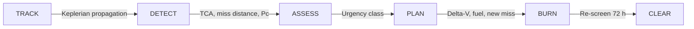
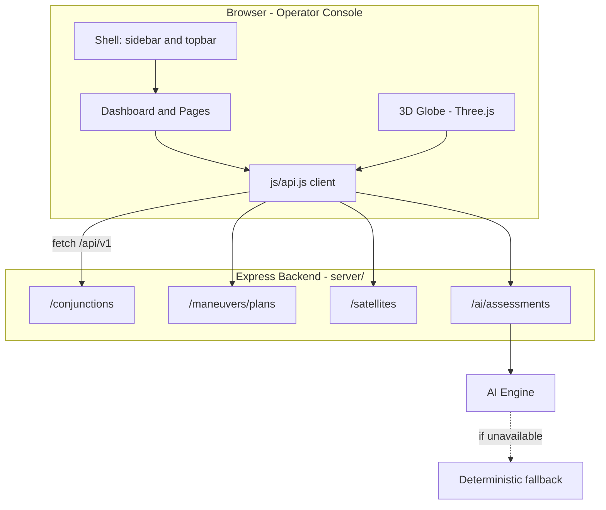
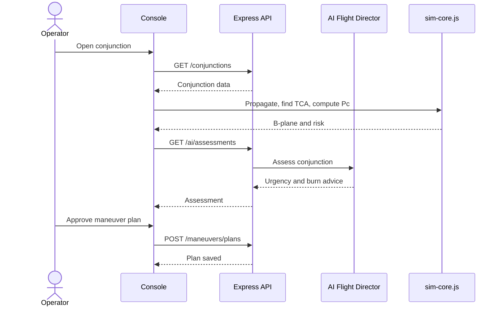
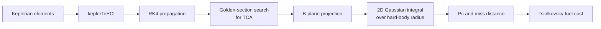
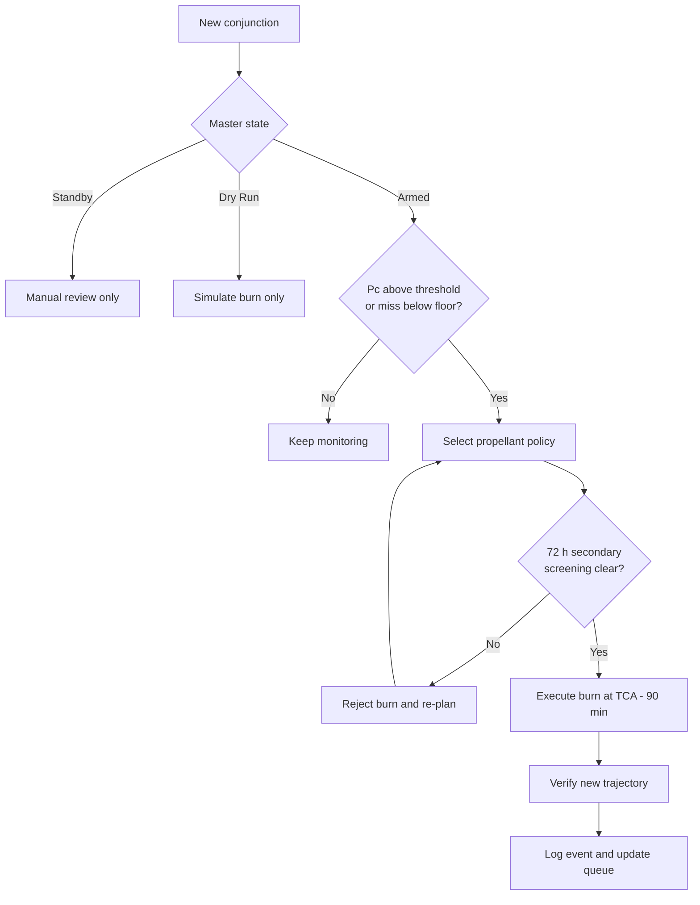
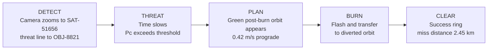

<div align="center">

# SOS - Safe Orbit for Satellites

**An autonomous mission-control console that watches LEO satellites, detects debris conjunctions, and plans collision-avoidance maneuvers, all visualised on a live 3D globe.**


[Overview](#overview) | [Background](#background-and-theory) | [Workflow](#collision-avoidance-workflow) | [Architecture](#system-architecture) | [Features](#features) | [Demo](#built-in-demo) | [Quick Start](#quick-start) | [Glossary](#glossary)

</div>

---

## Overview

SOS works like an air-traffic-control screen for space. It tracks satellites and debris, warns operators when a close pass is predicted, and proposes a small thruster burn to move the satellite out of danger.

The system covers the full loop: tracking, detection, risk assessment, maneuver planning, execution and post-burn verification. Operators can run each step by hand or let the autopilot handle it.


---

## Background and Theory

This section explains the science behind the console. Open each topic for details.

<details open>
<summary><b>1. Why collision avoidance matters</b></summary>

<br>

Low Earth Orbit (LEO, roughly 160 to 2,000 km altitude) is the most crowded region of space. Active satellites share it with dead satellites, spent rocket stages and fragments from past collisions and tests. Objects in LEO travel at about 7.5 km/s, and two objects on crossing orbits can meet at relative speeds of 10 to 15 km/s. At that speed even a fragment a few centimetres wide carries enough energy to destroy a satellite.

Most debris is too small to track, and tracked objects are only known to within some uncertainty. This is why operators work with probabilities rather than certainties, and why a warning usually arrives a few days before the encounter and is refined as new tracking data comes in.

The long-term risk is the **Kessler Syndrome**: a collision creates thousands of new fragments, which raise the chance of further collisions, which create more fragments. Avoiding even a single collision helps keep orbits usable.

</details>

<details>
<summary><b>2. Orbits and Keplerian elements</b></summary>

<br>

Under the two-body assumption, an orbit is an ellipse with Earth at one focus. Six numbers, the **Keplerian elements**, describe it completely:

| Element | Symbol | What it describes |
|---------|--------|-------------------|
| Semi-major axis | a | Size of the orbit (sets altitude and period) |
| Eccentricity | e | Shape: 0 is a circle, closer to 1 is a stretched ellipse |
| Inclination | i | Tilt of the orbit plane relative to the equator |
| RAAN | Omega | Where the orbit crosses the equator going north (rotates the plane) |
| Argument of perigee | omega | Where the lowest point lies within the plane |
| Mean anomaly | M | Where the object is on the orbit at a given time |

The orbital period follows from the semi-major axis:

$$T = 2\pi\sqrt{\frac{a^{3}}{\mu}}, \qquad \mu = 398{,}600.4\ \text{km}^3/\text{s}^2$$

For example, a satellite at 529 km altitude has $a \approx 6{,}907$ km, giving a period of about 95 minutes and a speed near 7.6 km/s. This matches the SAT-51656 values shown in the console.

SOS converts these elements into 3D position every frame (`keplerToECI`) in the **ECI frame** (Earth-Centered Inertial), a non-rotating frame fixed to the stars, which is the natural frame for orbital motion.

</details>

<details>
<summary><b>3. Propagation: predicting where objects will be</b></summary>

<br>

To find a future close approach, both orbits must be advanced forward in time. SOS uses two approaches:

- **Analytic Kepler propagation** for the real-time globe. Fast, and enough to draw smooth orbits.
- **RK4 numerical integration** (fourth-order Runge-Kutta) in `js/sim-core.js` for conjunction analysis. It steps the equations of motion in small increments and stays accurate over many orbits.

In real operations, accuracy is limited by perturbations: Earth's non-spherical shape (the J2 effect), atmospheric drag, solar radiation pressure and third-body gravity. Drag is especially important in LEO and depends on the atmosphere density, which changes with solar activity. That is why the console shows space-weather indices (F10.7 solar flux and the geomagnetic Kp index) and a drag-density multiplier next to the conjunction data.

</details>

<details>
<summary><b>4. Conjunctions, TCA and miss distance</b></summary>

<br>

A **conjunction** is a predicted close pass between two space objects. Each conjunction record carries:

| Quantity | Meaning |
|----------|---------|
| TCA | Time of Closest Approach, found with a golden-section search over the propagated trajectories |
| Miss distance | Separation at TCA, split into Radial, In-Track and Cross-Track components |
| Relative velocity | Closing speed at TCA, which sets the collision energy |
| Pc | Probability of Collision |
| Screening volume | The box around the primary used to filter candidate objects (10 x 10 x 10 km in the console) |

The **radial / in-track / cross-track (RTN)** frame is attached to the satellite: radial points away from Earth, in-track points along the velocity, and cross-track is perpendicular to the orbit plane. Operators think in this frame because burns and uncertainties are easiest to express in it. Uncertainty is usually largest in the in-track direction, because small timing errors grow into large along-track position errors.

Tracking agencies issue updates as **Conjunction Data Messages (CDMs)**. The Probability Evolution table in the console shows how Pc and miss distance change across successive CDMs, so operators can see whether a threat is growing or fading.

</details>

<details>
<summary><b>5. The B-plane and probability of collision</b></summary>

<br>

Because the objects move so fast, the encounter lasts only a fraction of a second, and the relative motion is almost a straight line. This allows a useful simplification: project everything onto the **B-plane**, the plane through the primary that is perpendicular to the relative velocity. The 3D problem becomes a 2D one.

On the B-plane:

- The secondary object appears as a point at the **nominal miss vector**.
- Position uncertainty of both objects, combined, forms a **covariance ellipse** (drawn at 1 sigma, 2 sigma and 3 sigma).
- The **Hard-Body Radius (HBR)** is a circle whose radius is the sum of both objects' physical sizes. If the objects pass inside this circle, they collide.

The probability of collision is the part of the uncertainty distribution that falls inside the HBR circle:

$$P_c = \iint_{x^2+y^2 \le R_{HBR}^2} \frac{1}{2\pi\sqrt{|\Sigma|}}\exp\!\left(-\tfrac12(\mathbf{r}-\boldsymbol{\mu})^{T}\Sigma^{-1}(\mathbf{r}-\boldsymbol{\mu})\right)dx\,dy$$

where $\Sigma$ is the combined 2x2 covariance, $\boldsymbol{\mu}$ is the nominal miss vector and $R_{HBR}$ is the hard-body radius. SOS evaluates this integral numerically.

A small miss distance with a large uncertainty can give a lower Pc than a larger miss with a very tight uncertainty, which is why both miss distance and Pc are always shown together.

**Risk tiers used by the console:**

| Tier | Rule |
|------|------|
| Critical | Pc of 1e-4 or higher, or miss distance under 100 m |
| High | Pc between 1e-5 and 1e-4, or miss distance under 1 km |
| Routine | Pc below 1e-5 and miss distance of 1 km or more |

The 1e-4 level matches the red threshold commonly used in NASA conjunction assessment practice.

</details>

<details>
<summary><b>6. Maneuver theory: how a small burn avoids a collision</b></summary>

<br>

A burn changes the satellite's velocity by **delta-V** (in m/s). The effect depends on the direction:

| Direction | Effect | Typical use |
|-----------|--------|-------------|
| Prograde / retrograde (in-track) | Changes orbit size and period, so the satellite arrives earlier or later at the encounter point | Most fuel-efficient, preferred when there is time |
| Radial | Changes the shape of the orbit and shifts position up or down | Fast geometric deflection |
| Cross-track | Tilts the orbit plane | Costly, used for urgent near-TCA threats |

The in-track burn works through a phase shift. A velocity change of delta-V changes the period, and the satellite then drifts ahead of or behind its original position more each orbit. As a rough guide:

$$\Delta s_{\text{along-track}} \approx 3\,T\,\Delta V \ \text{per orbit elapsed}$$

For a 95-minute orbit and 0.42 m/s, this is on the order of several kilometres of along-track shift after one orbit. This is why a tiny burn made about one orbit before TCA can be enough, and why the autopilot defaults to firing at TCA minus 90 minutes.

**Fuel cost** follows the Tsiolkovsky rocket equation:

$$\Delta m = m_0\left(1 - e^{-\Delta V/(I_{sp}\,g_0)}\right)$$

where $I_{sp}$ is the thruster's specific impulse (efficiency) and $g_0 = 9.80665$ m/s^2. Chemical thrusters (for example hydrazine, Isp near 230 s) give high thrust but use more propellant per unit delta-V. Electric thrusters (Isp near 1,600 s) are far more fuel-efficient but need longer burns. The console shows each satellite's remaining fuel and delta-V budget for this reason.

**Safety checks after planning:**

- The post-burn trajectory is screened for 72 hours so the burn does not push the satellite toward another object.
- A recovery maneuver returns the satellite to its nominal orbit afterwards (within 14 days in the Plan A example).
- Burn timing is checked against ground-station visibility so operators can monitor it live.

</details>

<details>
<summary><b>7. Autonomy and the AI Flight Director</b></summary>

<br>

At fleet scale, humans cannot review every alert in time. SOS offers two layers of automation:

- **Autopilot Engine.** A rule-based, closed-loop policy: when Pc exceeds a threshold, or the miss distance falls below a floor, a burn is planned and executed automatically. Rules are transparent and configurable, which makes behaviour predictable and auditable.
- **AI Flight Director.** An AI advisor that reads a conjunction and writes a structured recommendation with an urgency class (IMMEDIATE or MONITOR). If the AI is unavailable, a deterministic math fallback produces an answer, so the console never loses its decision support.

The AI advises; the numerical physics and the autopilot rules make the final checks.

</details>

<details>
<summary><b>8. Standards and data exchange</b></summary>

<br>

SOS exports warnings as **CCSDS Conjunction Data Messages**, the international standard that space agencies and operators use to share conjunction data. Using a standard format means a warning from one organisation can be read directly by another without translation.

</details>

---

## Collision-Avoidance Workflow

Every event follows six stages, from tracking to verified clearance.



<details>
<summary><b>Stage details</b></summary>

| Stage | What happens |
|-------|--------------|
| Track | Every object is propagated along its orbit from six Keplerian elements, so the globe is a live digital twin of the real orbits. |
| Detect | The backend creates a conjunction record with TCA, miss distance, Pc and relative velocity. The dashboard alert and a red pulsing globe marker appear. |
| Assess | The AI Flight Director assigns an urgency class. In parallel, `sim-core.js` propagates both orbits, finds TCA, builds the B-plane and computes Pc. |
| Plan | The Maneuver Planner proposes candidate burns with delta-V, direction, fuel cost, new miss distance and risk reduction. |
| Burn | The approved plan fires at the scheduled window, manually or through the Autopilot Engine. The satellite moves to the post-maneuver orbit. |
| Clear | The new trajectory is re-screened for 72 hours, the event is logged and a CCSDS CDM can be exported. |

</details>

---

## System Architecture



The frontend never holds the source of truth. Every page loader under `js/pages/` fetches what it needs through the shared client, and the persistent shell wraps each page. If the backend or AI engine goes down, the globe keeps running on its own Kepler math and the AI endpoints return fallback answers.

<details>
<summary><b>Component map</b></summary>

| Part | Role | Location |
|------|------|----------|
| Frontend | Operator pages and dashboards | `index.html`, `*.html`, `js/`, `css/` |
| 3D Globe Engine | Earth, satellites, debris, orbits | `js/orbital.js`, `js/sim-core.js` |
| Backend API | Satellites, conjunctions, maneuver plans | `server/` |
| AI Flight Director | Burn recommendations with math fallback | `server/` (`/api/v1/ai`) |
| Orbital Math | Propagation, TCA search, Pc | `js/sim-core.js` |

</details>

### Request Sequence



### Orbital Math Pipeline



### 3D Globe Rendering

Each object's elements are turned into an ECI position every frame and advanced using its period. Positions are scaled (1 km equals 0.001 units, so Earth's radius is about 6.378 units) and drawn on a textured Three.js sphere with a starfield and atmosphere glow.

| Color | Meaning |
|-------|---------|
| Cyan | Selected or primary satellite |
| Red dashed | Debris or dangerous object |
| Green dashed | Post-maneuver orbit |
| Red pulsing ring | TCA encounter marker |

---

## Features

Click a feature to view its interface and what it does.

<details open>
<summary><b>1. SSA Console (Mission Control)</b></summary>

<br>

The main dashboard for Space Situational Awareness (SSA), meaning knowledge of what is in orbit and where it is going. It brings together space weather, prioritised conjunction cards, the B-plane plot, the maneuver simulation lab and per-satellite propulsion status on one screen.

Space-weather tiles (F10.7 solar flux, Kp index, drag-density multiplier and catalog sync) matter because a stronger solar and geomagnetic state heats and expands the upper atmosphere, raising drag and making orbit predictions less certain. Each conjunction card shows a live TCA countdown and the miss distance split into radial, in-track and cross-track parts.


- Severity tiers: Critical, High, Routine
- Propulsion subsystem data: thruster type, Isp, chamber pressure, fuel remaining
- Delta-V budget bar showing how much maneuvering capability is left
- CCSDS CDM export and Autopilot policy shortcut

</details>

<details>
<summary><b>2. Conjunction Analysis (SSA Tactical)</b></summary>

<br>

A detailed view of one close approach. The geometry panel animates both objects approaching TCA, with a B-plane inset that shows the covariance ellipse against the hard-body keep-out circle. The risk panel summarises Pc, miss distance, relative velocity, combined uncertainty and the screening volume, followed by a plain-language assessment.

The event history and Probability Evolution table list each CDM update. A steadily rising Pc across updates is a strong sign that a maneuver is needed, while a falling one suggests the threat is passing.


- Close-approach geometry with 1, 2 and 3 sigma covariance
- Orbital data for both objects (altitude, inclination, period, eccentricity, type)
- Tabs: Overview, Analysis, History, Maneuver Options

</details>

<details>
<summary><b>3. Maneuver Planner</b></summary>

<br>

Turns a high-risk conjunction into a decision. The planner generates several candidate burns and lets the operator compare the trade-off between fuel spent and risk removed. A slider sets the burn window, and the orbital comparison canvas draws the current orbit, debris orbit and each plan's diverted orbit from propagated geometry.

In the example, Plan A is recommended: 0.42 m/s prograde, raising the miss distance to 2.5 km and cutting risk by 92.1 percent for a very small fuel cost. Plan B saves fuel but leaves a smaller margin; Plan C gives the largest margin at a higher cost.


- Plans A, B and C ranked by delta-V, fuel impact, new miss distance and risk reduction
- Burn direction, duration, thrust, altitude change and post-burn Pc
- Notes on ground-station visibility and recovery timeline

</details>

<details>
<summary><b>4. Fleet Telemetry (Satellite Registry)</b></summary>

<br>

A searchable registry of every monitored spacecraft. It spans several orbit classes: LEO and sun-synchronous Earth-observation satellites, geostationary communications satellites, highly elliptical and inclined geosynchronous orbits, and an L1 halo-orbit observatory. Different regimes carry different collision risk, with LEO being the most crowded.


- Filter by Operational, Degraded, Standby
- Search by name, ID or NORAD number
- Altitude, inclination, operator and orbit class per satellite

</details>

<details>
<summary><b>5. Autonomous Autopilot Engine</b></summary>

<br>

A closed-loop policy engine for fleet-wide self-protection. The operator defines the rules once and the engine applies them to every conjunction.


| Setting | Purpose |
|---------|---------|
| Pc trigger threshold | Probability above which an avoidance burn is triggered |
| Minimum miss distance | Hard keep-out floor that triggers planning regardless of Pc |
| Execution horizon | Burn timing before TCA (default 90 minutes, about one orbital period) |
| Propellant policy | Fuel-optimal in-track, rapid radial/cross-track, or constellation safe slot |
| 72-hour screening gate | Blocks any burn that would create a new conjunction |
| Master state | Standby (manual only), Armed (auto-execute), Dry Run (simulate only) |

The fleet-wide clearance queue lists each threatened spacecraft with its challenger debris, current risk, planned delta-V, propellant use and the predicted post-burn miss distance and Pc. Operators can batch-scan the fleet and execute all eligible clearances at once.

</details>

<details>
<summary><b>6. Analytics</b></summary>

<br>

Reports how well the screening and avoidance process is performing over 7, 14 or 30 days. Operators use it to spot trends, such as which altitude bands attract the most conjunctions, and to measure how much risk the executed maneuvers removed.


- Total conjunctions, average Pc, maneuvers executed and risk reduction
- Breakdown by severity, orbit regime and altitude band
- Top objects by conjunction count
- Report export

</details>

<details>
<summary><b>7. AI Flight Director</b></summary>

<br>

Reads a conjunction and writes a structured burn directive with an urgency class. Results feed the dashboard's AI Assessment bar (risk trend, Pc and driver). When the AI engine is not reachable, deterministic fallback logic keeps assessments available, so the operator is never left without a recommendation.

</details>

---

## Autopilot Decision Flow



---

## Built-in Demo

Press the red **COLLISION-AVOIDANCE DEMO** button on the home globe to play the full workflow in about 23 seconds. The demo uses a slightly exaggerated post-burn orbit so the diverted track is visible, and closing it restores the real fleet.



---

## Quick Start

```bash
npm install      # install backend dependencies
npm run dev      # start backend and static frontend
```

Open `http://localhost:3000`, then click **Launch Console** or run the demo. The frontend needs no build step.

---

## Project Structure

```text
.
|-- index.html            Landing and home globe
|-- *.html                Console pages
|-- css/                  Styles (including demo.css)
|-- js/
|   |-- orbital.js        3D globe and Kepler propagation
|   |-- sim-core.js       RK4, TCA, B-plane, Pc
|   |-- collision-demo.js Cinematic demo
|   |-- api.js            Shared API client
|   |-- shell.js          Sidebar and topbar
|   `-- pages/            Per-page loaders
|-- server/               Express API and AI routes
`-- docs/screenshots/     README images
```

---

## Glossary

<details>
<summary><b>Expand terms</b></summary>

| Term | Meaning |
|------|---------|
| Conjunction | A predicted close pass between two space objects |
| TCA | Time of Closest Approach |
| Pc | Probability of Collision |
| Delta-V | Velocity change from a thruster burn (m/s) |
| Isp | Specific impulse, a measure of thruster fuel efficiency |
| B-plane | Encounter plane perpendicular to the relative velocity |
| HBR | Hard-Body Radius, the combined physical size of both objects |
| Covariance | Statistical description of position uncertainty |
| ECI | Earth-Centered Inertial reference frame |
| RTN | Radial, In-Track, Cross-Track frame attached to a satellite |
| Keplerian elements | Six numbers that fully describe an orbit |
| SSA | Space Situational Awareness |
| CDM | Conjunction Data Message, the standard warning format |
| CCSDS | Consultative Committee for Space Data Systems, the standards body |
| Kessler Syndrome | Cascading collisions caused by accumulating debris |

</details>

---

<div align="center">

Built SOS by **Team SOS**

</div>
